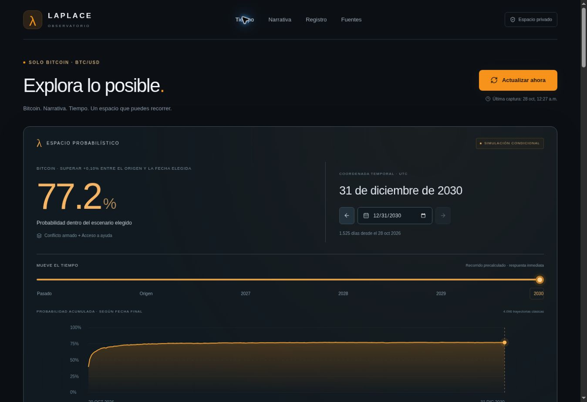
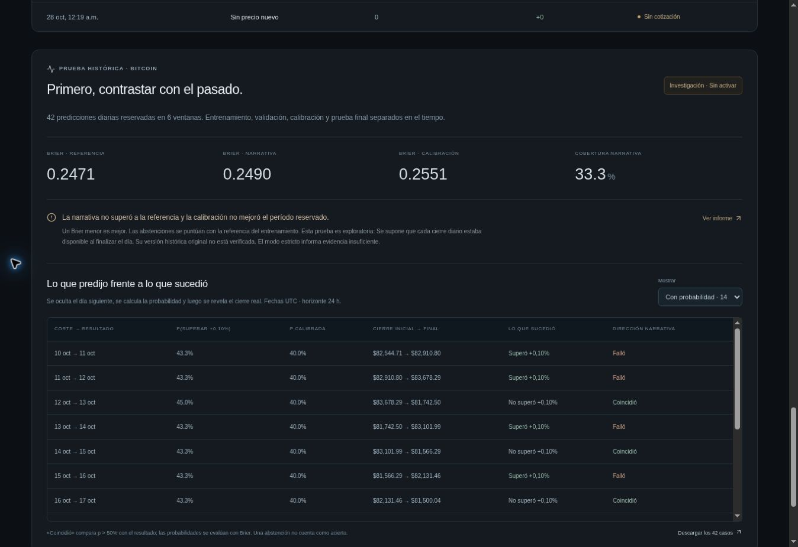

# Bitcoin: observación actual y calibración histórica

## Núcleo temporal vigente

La proyección bootstrap descrita a continuación **fue retirada de la interfaz**. El núcleo vigente aprende y propaga transiciones narrativas en operaciones nativas sobre la memoria original. Proyecta cada día hasta 2030 con sus probabilidades positiva y negativa, sin bloquear fechas por el alcance de las pruebas. [Dinámica nativa, resultados y reproducción](DINAMICA.md).

## Experimento temporal anterior, conservado para auditoría

El control principal permite mover la fecha desde el 12 de septiembre de 2026 hasta el **31 de diciembre de 2030**. El calendario, el deslizador, las flechas de un día y los saltos de año consultan el mismo cálculo. El recorrido futuro completo se prepara en un Web Worker y se guarda en memoria; mover la fecha no vuelve a sortear sus trayectorias. Cambiar narrativa, cantidad de trayectorias o semilla crea un cálculo nuevo y reproducible.

Para el pasado se recuperan los 42 pronósticos archivados y sus resultados, sin reescribirlos con hipótesis del usuario. Las abstenciones siguen sin probabilidad y las fechas sin pronóstico muestran su ausencia. Los controles narrativos se bloquean y muestran los temas que estaban registrados en ese corte.

Para el futuro se calcula una **simulación condicional**, con origen fijo en el 28 de octubre de 2026. La narrativa inicial corresponde al último archivo disponible, del 27 de octubre. Las casillas declaran qué temas se suponen presentes durante el horizonte; no son noticias del futuro. Los temas sin condiciones aprendidas se identifican como «sin soporte» y no reciben un efecto inventado.

`bitcoin/perfil-tiempo.mjs` recupera el último checkpoint del informe mediante el runtime XI original. Exporta una copia de consulta con su hash, las condiciones y las magnitudes de retorno de **solo los 28 días de entrenamiento**. La autoridad del modelo permanece en el checkpoint nativo. La estimación numérica y el muestreo del navegador son clásicos.

Para un patrón con `s` positivos y `n` observaciones, cada trayectoria extrae una probabilidad diaria de `Beta(s + 8*p0, n - s + 8*(1-p0))`, donde `p0` es la referencia del entrenamiento. Si no hay patrón, la ruta narrativa se abstiene y la simulación se identifica como referencia histórica, con `Beta(S+1, N-S+1)`. No se disfraza esa referencia como señal narrativa.

Se mantiene esa probabilidad dentro de cada trayectoria y se muestrean retornos logarítmicos diarios de la clase positiva o negativa del entrenamiento. Se suman hasta cada fecha. La fracción de trayectorias cuyo retorno compuesto supera +0,10% produce la probabilidad del escenario, junto con los conteos positivos y negativos. Este objetivo acumulado difiere del objetivo histórico de 24 horas y se identifica así en la consola. No se generan anuncios ni cotizaciones futuras como si fueran observaciones.

La semilla inicial es 271828; se permiten 1.024, 4.096 u 8.192 trayectorias en la interfaz. El botón de exportación guarda fecha, semilla, hipótesis, conteos y hashes. El muestreo es una adaptación propia de simulación por trayectorias y remuestreo empírico; [Hyndman y Athanasopoulos explican simulación de futuros mediante bootstrap](https://otexts.com/fpp3/toolbox.html). El modelo añadido supone independencia condicional diaria y estabilidad del escenario; no se ha demostrado que esas hipótesis describan Bitcoin hasta 2030. El resultado negativo de la prueba histórica permanece visible.

Reproducir el perfil verificado:

```bash
node tools/laplace.mjs preparar-tiempo evidencia/BTC-HISTORICO.json evidencia/BTC-CALIBRACION.json ./build-ether/mundo_x_quantum registros/perfil-tiempo-001.json
```

`evidencia/BTC-TIEMPO.json` contiene el perfil y `BTC-TIEMPO-RESULTADO.json` los cálculos reproducibles en cinco fechas. Las pruebas contrastan las condiciones portables con el modelo nativo en las **2.048 combinaciones** del vocabulario y verifican límites, fechas bisiestas, conteos, repetición de semilla y conservación del pasado.

Vista local del control temporal, con la fecha de 2030 y el mismo cálculo reproducible servido en el sitio:



El objetivo de mercado de Laplace queda limitado a **BTC-USD**. Los módulos E001–E004 y el runtime original permanecen disponibles. Los dos resultados de E003 conservan su significado; este agente recoge evidencia y la calibración actúa sobre la ruta probabilística, sin convertirla en una ley determinista.

## Observatorio privado

[Abrir Laplace Bitcoin](https://laplace-bitcoin-observatorio.guadalupejuan001.chatgpt.site).

«Actualizar ahora» consulta Coinbase Exchange, CoinDesk, Decrypt, Cointelegraph, SEC, Reserva Federal, BCE y ONU Noticias. Guarda la operación de mercado con fecha original, captura y decimal original; recoge hasta cinco titulares relevantes por fuente con sus enlaces. Los medios se filtran a Bitcoin; los organismos oficiales pueden aportar contexto. Las categorías monetaria y regulatoria son visibles, pero no entran como características del predictor geopolítico/humanitario.

Cada captura es independiente y persiste en D1. Un bloqueo temporal evita actualizaciones simultáneas. Los titulares repetidos conservan su primera fecha de captura; las actualizaciones posteriores solo registran que se volvieron a observar. Una caída de una fuente queda registrada y no fabrica valores. La cotización es `spot_quote`: no se presenta como cierre diario ni se incorpora como tal al entrenamiento.

El código canónico es `bitcoin/agente.mjs`; el sitio usa una copia idéntica. El proyecto del sitio es `appgprj_6ae174ecf0f88191b2304800cdbf4ad6`, con repositorio de fuente gestionado separado. No contiene claves de bolsa ni ejecuta órdenes.

Para una captura local nueva:

```bash
node tools/laplace.mjs actualizar-bitcoin registros/captura-001.json registros/hechos-001.jsonl
```

Crear antes `registros/`. Los archivos existentes no se sobrescriben. Exportar una noticia antigua encontrada hoy conserva `known_at` de hoy: no transforma su título actual en una versión histórica.

## Prueba corta del pasado

La métrica es `Y = 1` si el cierre BTC/USD aumenta más de **10 puntos básicos** durante las próximas **24 horas**; en otro caso, `Y = 0`. Es un coste total supuesto para definir la etiqueta, no un cálculo de rentabilidad ejecutable. Las únicas entradas de inferencia siguen siendo hechos geopolíticos y humanitarios.

Cada ventana usa 28 días de entrenamiento, 8 de selección/validación, 8 de calibración y 7 de prueba reservada. Avanza siete días; los períodos de prueba no se solapan. Se eliminan etiquetas que cruzan particiones. El prior se estima en entrenamiento; las condiciones se seleccionan en validación. Los parámetros se recuperan del estado Ether/XI nativo antes de emitir los pronósticos retrospectivos.

El calibrador prueba la rejilla fija `lambda = 1, 0.75, 0.5, 0.25, 0` para `p_cal = lambda*p + (1-lambda)*prior_cal`. La frecuencia de calibración usa suavizado `(positivos+1)/(n+2)`. Se ajusta únicamente con al menos ocho predicciones narrativas del tramo de calibración; con menos, conserva la identidad. Las abstenciones permanecen abstenciones. No se prueban parámetros contra las etiquetas finales para escoger un ganador.

Para repetir la descarga y las dos evaluaciones con nombres nuevos:

```bash
node tools/laplace.mjs descargar-bitcoin 2026-07-30T00:00:00Z 2026-10-28T00:00:00Z registros/historia-001.json
node tools/laplace.mjs calibrar-bitcoin registros/historia-001.json ./build-ether/mundo_x_quantum registros/estricta-001.json strict
node tools/laplace.mjs calibrar-bitcoin registros/historia-001.json ./build-ether/mundo_x_quantum registros/exploratoria-001.json exploratory_close_availability registros/pasado-001.json
```

`evidencia/BTC-HISTORICO.json` contiene la muestra descargada: 91 cierres y 715 anotaciones narrativas, con manifiesto, hashes y 91 archivos GDELT identificados. El muestreo toma un lote de las 00:00 UTC por día y hasta dos eventos por tema, sin elegirlos por resultados de precios. No representa todas las noticias ni todos los patrones posibles. El texto de cada anotación se genera desde los campos estructurados; no se descargan hoy los cuerpos de artículos antiguos.

GDELT `DATEADDED` identifica la incorporación al índice, distinta de la fecha del suceso. Se retrasa 24 horas y se toma además el máximo con `Last-Modified` del archivo; cada ZIP queda identificado por SHA-256. Los códigos CAMEO 073/0863 se relacionan con acceso/entrega de ayuda, 0871 con alto el fuego, 163 con sanciones y raíz 05 con cooperación diplomática. Raíces 19/20 y 1623 son proxies declarados: combate/violencia masiva no demuestra una escalada relativa y reducción de asistencia no demuestra bloqueo físico. Las anotaciones automáticas tampoco verifican la verdad del reporte. La región queda GLOBAL.

Los cierres de Coinbase descargados hoy **no incluyen versiones históricas originales verificadas**. El ledger conserva `known_at` de la descarga. Por eso el modo **strict** devuelve evidencia insuficiente para todos los cortes antiguos. El modo **exploratorio** crea solo en memoria una vista que supone disponibilidad al final de cada día. No modifica el ledger y deja la hipótesis explícita en el informe. La versión histórica de los precios sigue sin certificarse.

## Resultado guardado, sin ocultar el resultado negativo

`evidencia/BTC-CALIBRACION.json` conserva seis ventanas, 42 pronósticos reservados, sus hashes, observaciones y estadísticas por patrón/modelo. Los momentos `frozen_at` son cortes lógicos de la reconstrucción, no fechas reales de emisión en el pasado. Las 42 decisiones incluyen 14 probabilidades narrativas y 28 abstenciones. Estas últimas se puntúan con el prior congelado de su ventana.

| Puntuación Brier (menor es mejor) | Valor |
| --- | ---: |
| Referencia del entrenamiento | 0.247090 |
| Narrativa sin calibrar | 0.248952 |
| Narrativa calibrada | 0.255053 |

La narrativa no superó la referencia y el calibrador empeoró la prueba reservada. **No se activa como predictor en vivo.** El informe estricto se conserva por separado en `BTC-CALIBRACION-ESTRICTA.json`. La muestra es pequeña, el archivo narrativo está muestreado y la reconstrucción de precios tiene una hipótesis sin verificar: este resultado no acredita precisión, causalidad ni ventaja financiera.

El panel permite revisar las 42 fechas y filtrar las 14 con probabilidad o las 28 abstenciones. `evidencia/BTC-PASADO.json` compara cada pronóstico con los dos cierres reales. Por ejemplo, al corte del 10 de octubre, la probabilidad narrativa de superar +0,10% al día siguiente fue 43,33% (calibrada: 40%); el cierre pasó de 82.544,71 a 82.910,80 USD y superó el umbral. La dirección favorecida falló en ese caso. No se cuenta una abstención como acierto ni se reemplaza por una predicción segura después de conocer el resultado.

Las pruebas automáticas comprueban que alterar precios posteriores al corte de calibración no cambia el primer modelo, calibrador ni los pronósticos sellados. También rechazan etiquetas futuras, fechas falsas, ZIP fuera de límites y cotizaciones antiguas.

## Fuentes técnicas

- [Ticker público de Coinbase](https://docs.cdp.coinbase.com/api-reference/exchange-api/rest-api/products/get-product-ticker).
- [Velas de Coinbase: inicio del intervalo, campos y posibles ausencias](https://docs.cdp.coinbase.com/api-reference/exchange-api/rest-api/products/get-product-candles).
- [Contrato de campos GDELT 2.0](https://data.gdeltproject.org/documentation/GDELT-Event_Codebook-V2.0.pdf).
- [Manual de códigos CAMEO](https://data.gdeltproject.org/documentation/CAMEO.Manual.1.1b3.pdf).

El siguiente entrenamiento debe usar nuevas observaciones y nuevos períodos reservados. Reajustar sobre estos mismos 42 casos y volver a llamarlos prueba final contaminaría la evaluación.

Vista local de la comparación histórica, usando los mismos 42 casos servidos por el observatorio publicado. La tabla muestra tanto fallos como coincidencias; el filtro permite revisar también las abstenciones.


